<div align="center">

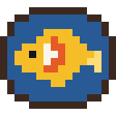

# Koi Atelier

**내 캐릭터만의 공방.** 잉어가 곁을 헤엄치고, 등에는 날개가, 머리 위엔 후광이.<br>
마인크래프트 감성 그대로의 도트 코스메틱과 편의 HUD를 한 모드에 담았어요.

[](https://www.minecraft.net)
[](https://fabricmc.net)
[](#)
[](LICENSE)
[](https://github.com/hamnnnyy/koi-atelier/releases/latest)
[](https://www.irisshaders.dev)

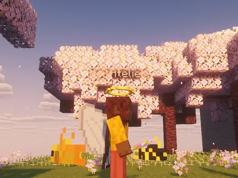

**[⬇ 다운로드](https://github.com/hamnnnyy/koi-atelier/releases/latest)** · **[▶ 전체 소개 영상 (60fps)](https://github.com/hamnnnyy/koi-atelier/releases/latest/download/koi-atelier-showcase.mp4)**

</div>

> 모든 꾸미기는 **내 화면에만** 보여요. 서버에 아무것도 설치할 필요가 없어서 어느 서버에서든 쓸 수 있어요.
>
> 📸 이 페이지의 영상과 이미지는 [Iris](https://www.irisshaders.dev) + [Complementary Reimagined](https://modrinth.com/shader/complementary-reimagined) 셰이더를 켜고 찍었어요. 셰이더가 없어도, 있어도 똑같이 동작해요.

---

## 🐟 잉어

금빛, 먹빛 잉어 두 마리가 캐릭터 주위를 헤엄쳐 돌아요. 꼬리를 흔들며 진행 방향을 바라보고, 위아래로 살랑살랑 출렁여요.
무늬 12종 × 염료 16색으로 마음대로 바꾸고, 크기, 반경, 높이, 속도까지 조절할 수 있어요. 속도를 음수로 하면 반대로 돌아요.

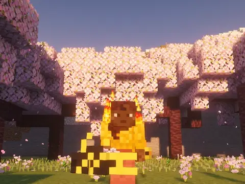

## 🔥 오라 · 발자국

어깨, 몸 둘레, 발밑에서 파티클이 피어오르고, 걸어간 자리엔 발자국이 남아요.
불꽃, 영혼 불꽃, 벚꽃잎, 엔드 막대 빛, 전기 스파크, 토템, 하트, 원하는 색의 가루까지 9종이에요.

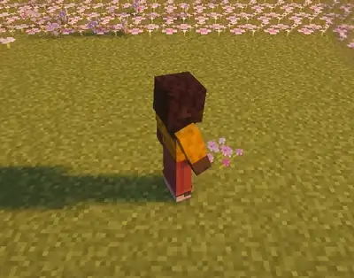

## 🪽 후광 · 날개

매끈한 그림을 붙이는 대신 **도트 한 칸 한 칸을 1/16블록 입체로 쌓아서** 만들었어요. 손에 든 아이템처럼 두께가 있고, 바닐라 조명대로 그늘이 져요.
천사, 나비, 드래곤 날개는 날 때 빠르게 퍼덕이고, 후광은 머리를 따라 기울어요. 색도 자유롭게 바꿀 수 있어요.

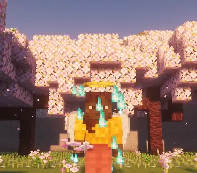

## 🧥 망토

바닐라 망토와 같은 방식으로 그려져서 걸으면 자연스럽게 펄럭여요. 엘리트라에도 같은 무늬가 입혀져요.
잉어, 불꽃, 벚꽃, 은하수, 바다 5가지 무늬가 있어요.

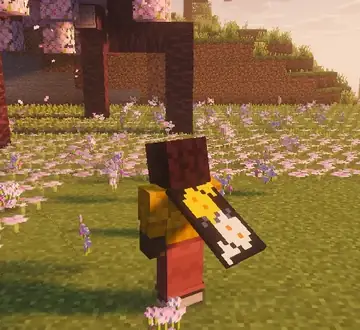

## 🐾 펫

어깨 옆을 둥실둥실 따라다니는 작은 친구예요. 걸으면 다리를 움직이며 부드럽게 따라와요.
알레이, 벌, 앵무새, 박쥐, 벡스, 고양이, 여우, 늑대, 토끼, 닭, 개구리, 아홀로틀 12종이 있어요.

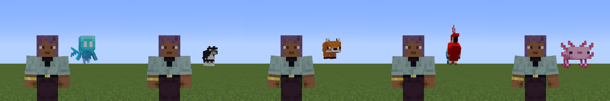

머리 위에 원하는 문구를 이름표처럼 띄울 수도 있어요 (`/koi head_text 문구`).

---

## 🧭 HUD · 편의 기능

| | |
|---|---|
| **좌표 · 방향 · 바이옴**<br>F3 없이 왼쪽 위에 작게 | **미니맵**<br>지도처럼 지형 표면만, 북쪽이 위 |
| 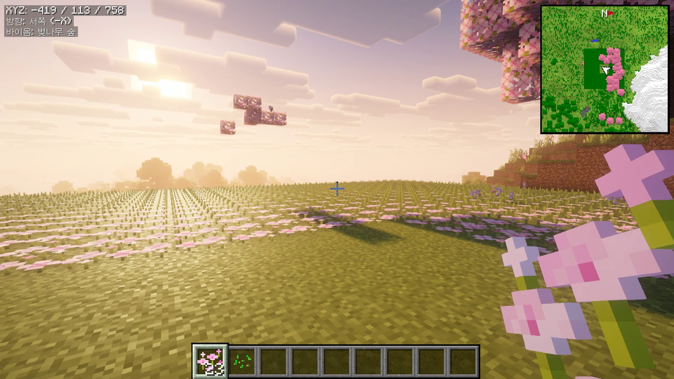 | 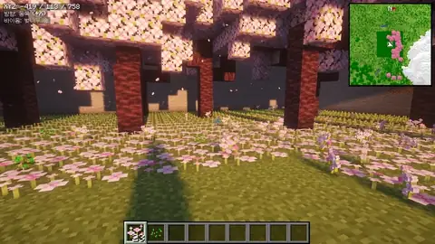 |
| **풀 브라이트** (B)<br>밤이나 동굴도 밝게, 셰이더를 켜도 동작 | **줌** (Z 누르고 있기)<br>부드러운 카메라로 확대 |
| 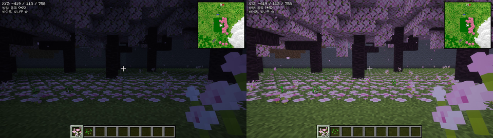 | **내구도 경고**<br>도구나 갑옷이 닳으면 알림과 종소리<br>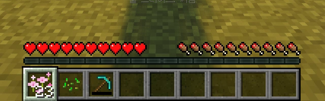 |

> 미니맵은 일부러 지형만 보여줘요. 몹 위치나 동굴 투시처럼 서버 규칙에 걸릴 수 있는 기능은 넣지 않았어요. 풀 브라이트는 서버에 따라 금지일 수 있으니 확인하고 쓰세요.

---

## ⚙️ 설정

### 설정 화면
채팅에 **`/koi menu`** (또는 `/koi open`, `/koi settings`)를 입력하거나, [Mod Menu](https://modrinth.com/mod/modmenu)의 설정 버튼을 눌러요.
꾸미기 페이지에서는 캐릭터를 3인칭 정면으로 보여줘서, 버튼을 누르는 즉시 결과를 확인할 수 있어요.

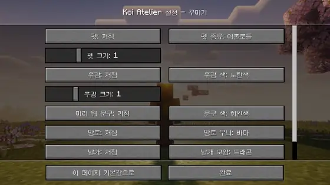

`/koi open <페이지>`로 원하는 페이지를 바로 열 수도 있어요. 완료를 누르면 메인 설정 화면으로 돌아가요.

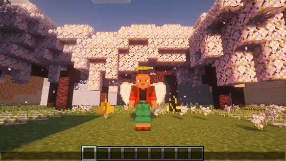

### 명령어
모든 설정은 명령어로도 바꿀 수 있어요. Tab 키로 자동완성돼요.

| 명령어 | 설명 |
|---|---|
| `/koi` | 전체 설정 보기 |
| `/koi menu` | 설정 화면 열기. `/koi open`, `/koi settings`도 같아요. |
| `/koi open <fish\|aura\|style\|hud>` | 그 페이지로 바로 열기. 예: `/koi open aura` |
| `/koi <설정> <값>` | 설정 하나 바꾸기. 예: `/koi wings_type dragon`, `/koi size 2` |
| `/koi <1\|2\|all> <무늬> <바탕색> <무늬색>` | 잉어 모양 한 번에. 예: `/koi all spotty white orange` |
| `/koi head_text <문구\|clear>` | 머리 위 문구 |
| `/koi reset` | 전부 기본값으로 |

### 단축키
설정 > 조작 > Koi Atelier 에서 바꿀 수 있어요.

| 키 | 기능 |
|---|---|
| `K` | 잉어 켜기/끄기 |
| `Z` | 줌 (누르고 있기) |
| `B` | 풀 브라이트 켜기/끄기 |
| (없음) | 설정 화면 열기 |

설정은 `config/koi-atelier.json` 에 저장돼요.

---

## 📦 설치

1. 마인크래프트 **1.21.1** 용 [Fabric Loader](https://fabricmc.net/use/) 를 설치해요.
2. [Fabric API](https://modrinth.com/mod/fabric-api) 와 [Koi Atelier](https://github.com/hamnnnyy/koi-atelier/releases/latest) jar를 `.minecraft/mods` 폴더에 넣어요.
3. (선택) [Mod Menu](https://modrinth.com/mod/modmenu) 를 넣으면 모드 목록에서 설정을 열 수 있어요.

> 망토가 안 보이면 설정 > 스킨 사용자 지정에서 **망토**가 켜져 있는지 확인하세요.
>
> [Sodium](https://modrinth.com/mod/sodium), [Iris](https://modrinth.com/mod/iris) 셰이더와 같이 써도 돼요 (Sodium 0.6 · Iris 1.8 · Complementary Reimagined에서 확인).

## 🛠 직접 빌드하기

Java 21이 필요해요.

```bash
./gradlew build                  # build/libs/koi-atelier-<버전>.jar
./gradlew runClient              # 개발용 클라이언트 실행
./gradlew runClient -Photswap    # 디버거 포트(5005)를 열고 실행. 코드를 고친 뒤 ./hotswap.sh 로 바로 반영
./gradlew runClient -Pshaders    # Iris + Sodium을 넣고 실행 (셰이더팩은 run/shaderpacks 에)
```

- 후광, 날개 도트 그림: [`KoiSprites.java`](src/client/java/io/github/hamnnnyy/koiatelier/KoiSprites.java) 에 글자로 그려져 있어요 (`W` 밝은 칸, `K` 테두리, `.` 빈칸).
- 망토, 아이콘 텍스처: `python tools/gen_textures.py` 로 다시 만들 수 있어요 (Pillow 필요).
- 설정 항목은 [`KoiOptions.java`](src/client/java/io/github/hamnnnyy/koiatelier/KoiOptions.java) 한 곳에서 정의되고, 설정 화면과 `/koi` 명령어가 여기서 자동으로 만들어져요.

## 📝 업데이트 내역

- **[1.0.2](https://github.com/hamnnnyy/koi-atelier/releases/tag/v1.0.2)**: `/koi open`, `/koi settings` 명령어로도 설정 화면을 열 수 있어요. `/koi open aura`처럼 페이지를 붙이면 그 페이지로 바로 열려요.
- **[1.0.1](https://github.com/hamnnnyy/koi-atelier/releases/tag/v1.0.1)**: 셰이더(Iris)를 켜도 풀 브라이트가 동작해요. Sodium · Iris 호환을 확인했어요.
- **[1.0.0](https://github.com/hamnnnyy/koi-atelier/releases/tag/v1.0.0)**: 첫 릴리스

## 📄 라이선스

[MIT](LICENSE) © hamnnnyy
